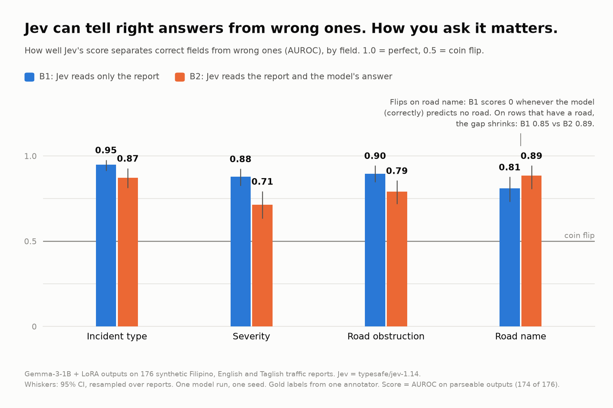

# trafficslm-jev-reward

**How closely can a decision model judge outputs without seeing the gold label, and where does it break?**

The decision model is Jev (`typesafe/jev-1.14`, OpenRouter `/api/alpha/decisions`), which answers narrow, typed
questions with probabilities. Here it scores a LoRA-tuned Gemma-3-1B's extractions from synthetic Filipino, English and
Taglish traffic reports (incident type, severity, road obstruction, road name), and the scores are compared with gold
labels. Two designs are compared: **B1** (Jev reads only the report) and **B2** (Jev reads the report and the model's
answer). This sprint measures reward quality only; no RL training was run.



Results and limits: [`jev_rl/docs/findings.md`](jev_rl/docs/findings.md). Run commands: [`jev_rl/README.md`](jev_rl/README.md).

## What is in this repo

- `jev_rl/`: the Jev reward code, tests, results and write-up.
- `data/processed/`: the synthetic dataset (207 / 40 / 176 train / validation / test reports) with gold labels, and
  `data/aliases.json` (road-name aliases used when matching locations). Label rules: `docs/annotation-guidelines.md`.
- `src/trafficslm/`: the small helpers the Jev code reuses (schema, data loading, scoring, prompts).
- `experiments/`: stored predictions of the four model runs that were scored (Gemma-3-1B zero-shot, few-shot and
  LoRA, Qwen2.5-1.5B LoRA). The fine-tuning code that produced them is not included.

## Setup

```
uv sync
uv run pytest jev_rl/tests -q
```

Calling Jev needs an OpenRouter key in `.env` (`OPENROUTER_API_KEY=...`, git-ignored). The API response cache is not in
the repo, so re-running costs API calls (about $0.10 for the whole sprint at list price) and answers may differ.
The test split can be scored once per run by design; see `jev_rl/README.md`.
